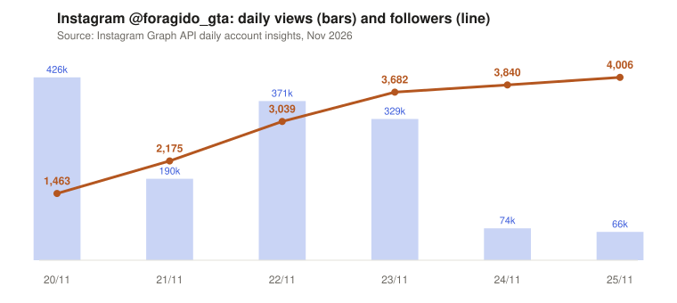
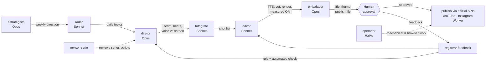

# ai-content-pipeline · Foragido GTA

*English below · [Português mais abaixo](#português)*

Case study of a **faceless GTA 6 channel run by Claude Code agents**: YouTube, Instagram and TikTok in Brazilian Portuguese. Claude researches, writes, edits, packages and schedules. One human (me) approves, directs and gives feedback, in roughly 20 minutes a day (my estimate, not measured).

**See it live:** [Instagram @foragido_gta](https://www.instagram.com/foragido_gta/) · [YouTube @foragido_gta](https://www.youtube.com/@foragido_gta)



This repository is a showcase, not a turnkey product. It holds the architecture, the agent definitions, the feedback system and real pieces of code. Credentials, voice files, third-party footage and audience data stay private. It is a clean snapshot: the private working repository has 172 commits since Oct 31, 2026.

## Results (measured, Nov 2026)
| Metric | Value | Source in the project |
|---|---|---|
| Instagram followers | 1,463 → **4,006** in 5 days (Nov 20 → 25) | daily account insights via API |
| Instagram views in a single day | **426,445** (Nov 20) | same |
| Best Reel | **246,525** views | per-post metrics sheet |
| Posts tracked (IG, YouTube, TikTok, X) | **453** | per-post metrics sheet |
| YouTube actions through the official API | 114 uploads, 92 captions, 157 playlist adds | API action log |
| Instagram posts scheduled in the cloud | 213 | API action log |
| Build | 172 commits in 3 weeks; 14 agents, 20 skills | git, `.claude/` |

**What did not work:**
- TikTok stopped distributing after 17/11.
- YouTube is still small (~72 subscribers, ~56k Shorts views in November).
- No revenue yet.

## Architecture


- **One agent per stage, one at a time.** The map of stages and hand-offs is in [docs/fluxos.md](docs/fluxos.md).
- **Model chosen by cost:**
  - Opus decides what the video *is* and how it is packaged;
  - Sonnet executes;
  - Haiku does mechanical work;
  - the most expensive model never runs in automated production.
- **A daily 4 a.m. run** only produces topics the human starred. A pre-check measures the GPU and skips the run when nothing is marked, so idle days cost no tokens.
- **Official APIs only.** YouTube Data and Analytics API and the Instagram Graph API, never browser automation of the social sites. The Instagram API has no scheduling, so a Cloudflare Worker publishes at the set time with the PC off ([nuvem/disparo-ig](nuvem/disparo-ig)).

## The feedback loop (the part that made quality compound)
Rules written on paper did not stop repeated mistakes; automated checks did. Every comment from the human goes through [skills/registrar-feedback](skills/registrar-feedback/SKILL.md):
1. It is logged verbatim.
2. It becomes a new or adjusted rule, with a confidence level: requested, confirmed, data-backed or hypothesis.
3. **If the defect is measurable, it becomes an automated check** in the script that runs at that stage. Each check is tested against the failing video (must fail) and an approved one (must pass).
4. Rejected copy is stored as "my version → his version" pairs and read before writing again.
5. Anything the human says to keep goes into a `manter.md` that blocks the render if it disappears in a later version.

## Code in this repository
| Path | What it is | Runs standalone? |
|---|---|---|
| `agents/` | 4 of the 14 agent definitions: director, editor, packager, operator | — |
| `skills/registrar-feedback/` | feedback → rule → check | — |
| `tools/youtube_api.py` | YouTube client: upload, schedule, captions, playlists, comments, metrics, retention | yes (needs your OAuth client) |
| `tools/instagram_api.py` | Instagram Graph client: Reel, photo, carousel, story, insights, cloud scheduling, safety brake | yes (needs `IG_ID` and a token) |
| `tools/layout.py` | measures the **final rendered frame**: caption axis, text at the edge or over other text | yes |
| `tools/volume.py` | measures and fixes loudness to −14 LUFS / peak < −1.5 dB without re-encoding video | yes |
| `tools/referencia/conferir.py` | the post-render QA that collects the measurable checks (sync, cut words, repeated shots, "keep" list…) | no: reference only, it imports private modules |
| `nuvem/disparo-ig/` | Cloudflare Worker that publishes scheduled Instagram posts | yes |

```bash
pip install -r requirements.txt
python tools/volume.py medir video.mp4
python tools/layout.py video.mp4
```

Code and comments are in Portuguese, the language the channel runs in. "JV" in the prompts is me, the human in the loop.

Built by João Victor Medawar Machado with Claude Code. MIT license (code only; no channel content is included).

---

## Português

Estudo de caso de um **canal "dark" de GTA 6 tocado por agentes do Claude Code**, com YouTube, Instagram e TikTok em português.
- **O Claude** pesquisa, escreve, edita, embala e agenda.
- **Eu** aprovo, dirijo e dou feedback, em cerca de 20 minutos por dia.

**Resultados medidos em nov/2026:**
- Instagram de 1.463 para **4.006 seguidores** em 5 dias (20 a 25/11), com **426.445 views** num único dia.
- Reel de **246.525 views**.
- **453 publicações** registradas.
- Pela API oficial: 114 uploads no YouTube e 213 posts agendados na nuvem.
- 172 commits em 3 semanas, com 14 agentes e 20 skills.

**O que não deu certo:**
- o TikTok parou de distribuir depois de 17/11;
- o YouTube ainda é pequeno;
- ainda não há receita.

**O que está aqui:**
- a arquitetura e os agentes, com o modelo de cada um escolhido por custo;
- o ciclo de feedback, em que cada comentário vira regra e, quando dá para medir, checagem automática;
- os clientes das APIs oficiais;
- o Worker de agendamento;
- as checagens de vídeo que rodam sozinhas.

Credenciais, voz, material de terceiros e dados do público ficam de fora.
